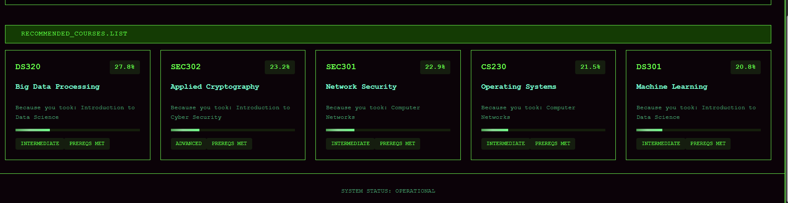

# Course Recommender

A web app that reads an academic transcript and recommends what to study next.
Upload a PDF or text transcript; a Flask backend extracts the courses you have
taken, scores a course catalogue against them with TF-IDF and cosine
similarity, and a React frontend shows the recommendations with charts.

Each recommendation explains itself ("suggested because you took Computer
Networks") and says whether you have already passed its prerequisites.

## Example



For the fictional sample transcript in `samples/` (Programming, Data
Structures, Computer Networks, Cyber Security, Data Science, Calculus):

| Recommended | Match | Because you took | Prerequisites |
|---|---|---|---|
| DS320 Big Data Processing | 27.8 | Introduction to Data Science | Met |
| SEC302 Applied Cryptography | 23.2 | Introduction to Cyber Security | Met |
| SEC301 Network Security | 22.9 | Computer Networks | Met |
| CS230 Operating Systems | 21.5 | Computer Networks | Met |
| DS301 Machine Learning | 20.8 | Introduction to Data Science | Met |

## How it works

```
transcript (PDF/TXT) -> transcript_parser.py -> courses taken -> recommender.py -> ranked courses -> app.py (JSON + charts) -> React UI
```

| File | Responsibility |
|---|---|
| `backend/transcript_parser.py` | Extracts text with pdfplumber and finds lines that start with a course code (`CS101`, `ECMM 422`), taking the words after it as the title |
| `backend/recommender.py` | Builds a TF-IDF vector for every catalogue course and every course taken, then scores each candidate by cosine similarity to the closest taken course |
| `backend/catalogue.csv` | 22 sample courses across programming, data science, security and maths |
| `backend/app.py` | Flask API: validates the upload, runs the pipeline, renders pie, bar and radar charts with matplotlib |
| `frontend/src/App.js` | React interface: upload, charts, recommendation cards and a course detail view |

**Why "closest taken course" rather than one combined profile?** Merging the
whole transcript into one vector dilutes it: a student with both security and
data courses matches nothing strongly. Scoring against each course separately
keeps strong, specific matches and makes every recommendation explainable.

## Privacy and security

A transcript holds personal data, so the backend is built to handle it carefully:

- **Never stored.** Uploads are read into memory, processed and discarded;
  nothing is written to disk.
- **Validated.** Only `.pdf` and `.txt` files are accepted, and uploads over 5 MB
  are rejected before processing.
- **Locked-down API.** CORS allows only the local React app
  (`http://localhost:3000`), and Flask's debug mode, which exposes an
  interactive console, is off unless `FLASK_DEBUG=1` is set.
- **Kept out of git.** `.gitignore` excludes PDFs, `uploads/` and `temp_*` files
  so a real transcript cannot be committed by accident.

## Running it

Requires Python 3.10+ and Node.js 18+.

```bash
git clone https://github.com/Ash86-cpu/Course-Recommender.git
cd Course-Recommender

# Backend (terminal 1)
cd backend
python -m venv .venv
.venv\Scripts\activate          # Windows; on macOS/Linux: source .venv/bin/activate
pip install -r requirements.txt
python app.py                   # http://localhost:5000

# Frontend (terminal 2)
cd frontend
npm install
npm start                       # opens http://localhost:3000
```

Then upload `samples/sample_transcript.txt`, or your own transcript.

## Tests

```bash
cd backend
python -m pytest -v
```

13 tests cover transcript parsing, the recommender (taken courses are excluded,
security history leads to security courses, prerequisites are checked, every
recommendation names its reason) and the API (valid upload, wrong file type,
transcript with no courses).

## Limitations

- **Parsing is heuristic.** It expects one course per line, starting with a
  course code. Transcripts laid out as tables with merged cells, or scanned
  images (which have no text layer), will not parse.
- **TF-IDF matches words, not meaning.** "Computer Networks" and "Neural
  Networks" share a word but not a subject. Repeating each course's subject
  area in its vector reduces this; sentence embeddings would solve it properly.
- **The catalogue is a small sample.** Real use would load a university's actual
  module catalogue.
- **Grades are ignored.** A course passed with a high mark could reasonably
  count for more than one barely passed.
